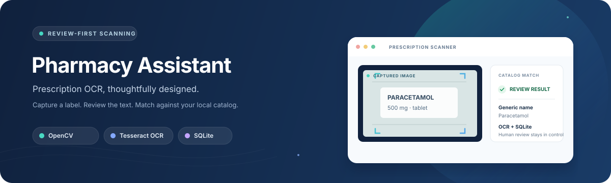
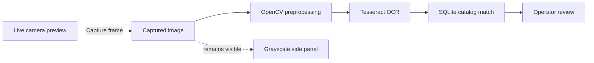

# Pharmacy Assistant

**A review-first prescription scanning desktop app** built with Python, Tkinter,
OpenCV, Tesseract OCR, and SQLite. Capture a prescription or medicine label,
review the recognized text, and compare it with a local medicine catalog.

[](https://www.python.org/)
[](https://opencv.org/)
[](https://github.com/tesseract-ocr/tesseract)
[](https://www.sqlite.org/)

> **Safety notice:** This project is a software demonstration, not a medical
> device or source of treatment advice. OCR can be wrong. Always verify the
> medicine and its details with an appropriate healthcare professional. The
> included demo catalog, quantities, and storage locations are fictional.
> Scanning does not dispense medicine or change inventory.

## What it does

- Shows a live webcam preview and keeps the captured, processed image visible
  separately while OCR runs.
- Uses the existing OpenCV preprocessing and Tesseract OCR pipeline.
- Matches recognized names, strengths, and dosage forms against a local SQLite
  catalog; unclear or incomplete details are marked for review.
- Shows generic names and sourced, general-use information for paracetamol,
  aspirin, and amoxicillin when available in the demo database.
- Provides a CLI as well as the desktop scanner.

## Scan workflow



The live preview resumes independently; the grayscale capture remains visible
until replaced or cleared. OCR results are suggestions for review, not a
confirmed prescription.

## Quick start

### Requirements

- Python 3.10 or newer
- Tesseract OCR installed and available on `PATH`
- A desktop session for the Tkinter interface and webcam preview
- A webcam for live scanning; image-file scanning does not require one

On Debian/Ubuntu, install the system packages:

```bash
sudo apt-get update
sudo apt-get install python3-tk tesseract-ocr
```

Create an environment and install the app:

```bash
cd /path/to/pharmacy_assistant
python3 -m venv .venv
source .venv/bin/activate
python -m pip install -e .
```

Create a local database with fictional demo medicines:

```bash
pharmacy-assistant init --db pharmacy.db --demo
```

Launch the scanner:

```bash
pharmacy-assistant gui --db pharmacy.db --camera 0
```

In the dashboard, use **Capture image** to scan the current frame. The captured
grayscale OCR image and results remain in the right panel while the live preview
continues. Use **Retake** or **Clear scan** to remove the current capture.

If the `pharmacy-assistant` command is not on your `PATH`, run the module from
the repository root instead:

```bash
PYTHONPATH=src .venv/bin/python -m pharmacy_assistant.cli gui \
  --db pharmacy.db --camera 0
```

## Other ways to scan

Scan a JPG, JPEG, or PNG file:

```bash
pharmacy-assistant scan --image /path/to/label.png --db pharmacy.db
```

Use the command-line webcam preview:

```bash
pharmacy-assistant scan --camera 0 --db pharmacy.db
```

The CLI camera preview uses **Space** to capture and **Esc** or **Q** to cancel.
Choose a different camera by changing the index, for example `--camera 1`.

Optionally select a custom Tesseract model:

```bash
pharmacy-assistant scan --image /path/to/label.png \
  --db pharmacy.db --ocr-model pharmacy_meds
```

Save diagnostic images and OCR attempts for troubleshooting:

```bash
pharmacy-assistant scan --image /path/to/label.png \
  --db pharmacy.db --debug-dir ./ocr-debug
```

## Results and review

The scanner presents OCR text, candidate medicine details, and database match
status. A confirmed match may also include the catalog’s generic name, brand,
strength, dosage form, demo location, and common-use reference. If only a
generic ingredient is recognized, ingredient-level information may be shown,
but the product remains marked for verification. The displayed OCR selection
score is a ranking value, not a probability of correctness.

The demo data includes general-use notes and links to [MedlinePlus drug
information](https://medlineplus.gov/druginformation.html). These short
summaries are not diagnosis, dosing instructions, or a recommendation to start,
stop, or change a medicine. In particular, aspirin may increase bleeding risk,
and antibiotics such as amoxicillin are used only for appropriate bacterial
infections.

## OCR data and evaluation

See [training/README.md](training/README.md) for image-labeling guidance and
dataset split rules. The capture helper records an image, exact operator-
provided transcription, and a manifest entry:

```bash
pharmacy-assistant capture --camera 0 --split test
```

Evaluation tools and experimental OCR options are separate from the default
scanner behavior. Do not tune OCR using held-out test images.

## Development

Run the test suite:

```bash
python -m unittest discover -s tests -v
```

Initialize an empty database instead of the fictional demo catalog:

```bash
pharmacy-assistant init --db pharmacy.db
```

The database schema and matching rules are in `src/pharmacy_assistant/`.
Medicine-name, strength, and dosage-form matching is conservative; ambiguous
matches require human review rather than substitution.

## Troubleshooting

- **Camera unavailable:** Check device permissions, close other camera apps, and
  try another index such as `--camera 1`.
- **No desktop preview:** Run from a desktop session with Tkinter available.
  Headless environments can use `--image` instead.
- **Tesseract unavailable:** Install `tesseract-ocr` and confirm `tesseract` is
  on `PATH`.
- **Poor OCR:** Improve focus and lighting, reduce glare, and keep the printed
  medicine name in frame. Handwriting and low-quality images may need manual
  review.
